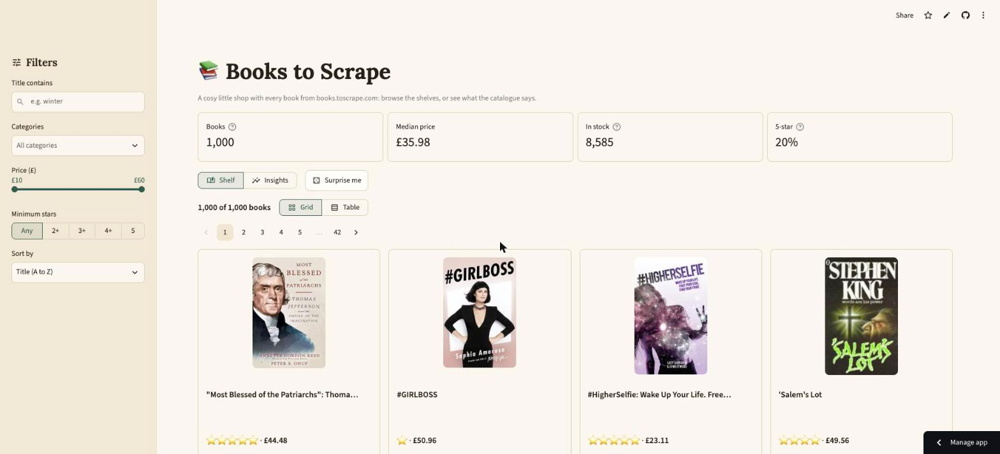
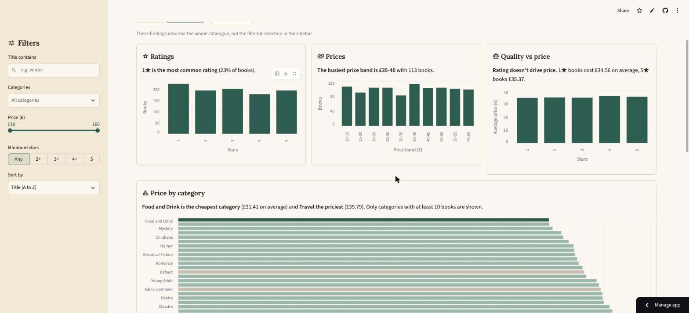

# Books to Scrape

Scrapes all 1,000 books from [books.toscrape.com](https://books.toscrape.com), a sandbox site made for
scraping practice, stores them in a Supabase (Postgres) database, and lets you browse, filter and
analyse them in a Streamlit app.

**Live demo:** <https://ap-books-to-scrape.streamlit.app/> (Streamlit Community Cloud, free tier: if it has been idle,
click "wake up" and wait ~30 s; if the free Supabase project has been paused for inactivity, the app shows a
"could not read the books" message, so run it locally in [sample mode](#setup) instead).



## Purpose
Project 2 of the course assignment: collect data from a website, store it in a database and present it through an
interface. The goal was a small but complete pipeline that someone else can rerun:

1. **Scrape** every book (title, price, rating, stock, category, description, cover) politely and repeatably.
2. **Store** it in a real cloud database with sensible tables and access rules, so the reading app can never change
   the data.
3. **Explore** it in a web app that feels like a small bookshop: browse covers, filter, open a book, and read a few
   honest findings about the catalogue.

## Data collection
`scraper.py` crawls [books.toscrape.com](https://books.toscrape.com) with `requests` and parses the pages with
BeautifulSoup (`parse.py`, pure functions that are tested on saved HTML pages).

- **Crawl:** the 50 listing pages (`catalogue/page-1.html` … `page-50.html`, 20 books each) are followed through
  their "next" link. Each book's product page gives title, UPC, prices (incl./excl. tax, tax), stock text
  ("In stock (22 available)"), star rating (a CSS class such as `star-rating Three`), description, category
  (3rd breadcrumb item) and cover image URL. Relative links are made absolute with `urljoin`.
- **Incremental by default:** all listing pages are crawled, but a product page is only fetched if its URL is not
  in the database yet, so a repeated run costs ~50 requests instead of ~1,050. `--full` refetches everything
  and updates the stored rows. `--limit N` stops after N books (handy for a first test); `--delay` sets the pause.
- **Politeness:** a pause before every request (0.2 s by default), a 10 s timeout, 3 attempts with 2 s / 4 s backoff
  on network errors and 5xx answers, and a generic User-Agent (`APAIF-coursework-scraper/1.0 (educational)`).
- **Errors:** a book that fails is printed and counted in `errors`; the run continues.
- **Encoding trap:** `requests` guesses ISO-8859-1 for this site and would turn "£" into "£", so the parser
  receives the response bytes and BeautifulSoup reads the page's own UTF-8 declaration.
- Not stored: "Number of reviews" (always 0 on this site).

```bash
# from inside books-to-scrape/, with the environment active (see Setup)
python scraper.py --limit 40   # test run
python scraper.py              # incremental
python scraper.py --full       # update everything
```

## Data persistence
Data lives in a Supabase (Postgres) project; the tables are created by [schema.sql](schema.sql).

| Table | Content |
|---|---|
| `categories` | `id`, `name` (unique): 50 rows. A separate table because the names repeat 1,000 times and the app needs the list. |
| `books` | `upc` (primary key, the site's own code), title, `category_id`, prices, stock, rating (1–5, checked by the database), description, image and product URL, `first_seen`, `last_scraped`. |
| `scrape_runs` | One row per run: mode, pages visited, new / updated / skipped books, errors, status (`running`, `ok`, `failed`). The app shows the latest one. |

- **Upserts:** books are written with `upsert(..., on_conflict="upc")`, once per listing page, so re-running never
  creates duplicates. `first_seen` is never sent, so the database default keeps the original date while
  `last_scraped` moves forward. New vs. updated is decided by comparing with the URLs already stored.
- **Supabase limit:** a request returns at most 1,000 rows, so the stored URLs are read in pages with `.range()`.
- **Keys and Row Level Security:** RLS is on for all tables with one policy, "anyone may SELECT". There is no
  insert/update policy, so the *publishable* key (used by the app) can only read. The *secret* key bypasses RLS and
  is used only by the scraper. Both live in `.env`, which is gitignored; `.env.example` holds placeholders.
- `db.py` write helpers take the client as an argument, so `tests/test_db.py` runs them against a fake client
  without touching the real database.

## User interaction
Start the app from inside `books-to-scrape/`: Streamlit reads the theme from `.streamlit/config.toml` in the folder
where it is started. It needs the Supabase keys in `.env`, or sample mode:

```bash
cd books-to-scrape
streamlit run app.py                        # real data from Supabase
BOOKS_SOURCE=sample streamlit run app.py    # no database needed
```

`BOOKS_SOURCE=sample` shows 60 synthetic books from `tests/fixtures/sample_books.csv` (no covers, so cards show a book
icon), so anyone can try the interface without a Supabase project. The app only ever uses the read-only publishable key.

The app looks like a small bookshop: a warm paper theme with a deep green accent and serif headings, set only in
`.streamlit/config.toml` (no custom CSS). Under the title, four tiles show books, median price, copies in stock and the
share of 5-star books. A switch below them chooses between two views, next to a **Surprise me** button that opens a
random book from the current selection:

- **Sidebar filters** (apply to the Shelf view): title search, categories, price range, minimum stars (Any, 2+ ... 5) and
  a sort order. There is no "in stock only" filter: every scraped book is in stock, so it would change nothing.
- **Shelf**: the matching books as a grid of cards (cover, title, rating, price, category), 24 per page with a page
  control. Every card is built from fixed-height zones, so covers, titles and buttons line up across a row.
  "x of y books" shows how many match. **Details** opens a dialog with the bigger cover, full description,
  prices with and without tax, copies available and a link to the book's page on the source site. A Grid/Table switch
  falls back to a plain table.
- **Insights** (the extra feature): short written findings computed from the data, each with a chart: the rating
  distribution, price bands of £5, whether rating drives price, and the average price per category (categories with at
  least 10 books; the cheapest and priciest are coloured, the site's placeholder categories greyed). Two shelves show
  the cheapest 5-star books and the books with the most copies in stock. These always describe the whole catalogue,
  not the filtered selection.
- **Footer**: the data source and, for Supabase, the date and mode of the latest scrape run.

Messages instead of crashes: missing or wrong keys (with the hint to use sample mode), an unreachable database, an
empty database ("run the scraper first") and a filter combination that matches nothing.

How it works: `queries.py` loads all books once (paged with `.range()`, because Supabase returns at most 1,000 rows per
request; the category name is joined in) and holds the filter and aggregate functions as plain pandas code, which
`tests/test_queries.py` checks offline. `app.py` only draws the interface (small functions: header, filters, cards, dialog, insights) and caches the loaded data for 10 minutes.

## Setup
Needs Python 3.12 and, for real data, a free [Supabase](https://supabase.com) account.

**1. Get the code and install the packages**

```bash
git clone https://github.com/mchlkan/APAIF_Assignment.git
cd APAIF_Assignment/books-to-scrape
conda create -n apaif python=3.12   # or any Python 3.12 virtual environment
conda activate apaif
pip install -r requirements.txt
```

**2a. Quick look without a database (sample mode)**

```bash
BOOKS_SOURCE=sample streamlit run app.py
```

This shows 60 synthetic books; everything works except real covers and the scrape-run footer.

**2b. Full setup with your own Supabase project**

1. In Supabase, create a project (any name, a strong database password; the code never needs that password).
2. Open **SQL Editor → New query**, paste the contents of [`schema.sql`](schema.sql) and click **Run**. It creates the
   three tables, the read-only policy and the grants, and is safe to run again.
3. Copy `.env.example` to `.env` (same folder) and fill in the values from **Project Settings → API keys** (and
   **Data API** for the URL): `SUPABASE_URL`, `SUPABASE_PUBLISHABLE_KEY` and `SUPABASE_SECRET_KEY`. The legacy
   `anon` / `service_role` keys work too. `.env` is gitignored; never commit it.
4. Scrape (a full run is ~1,050 requests and takes a few minutes), then start the app:

```bash
python scraper.py --limit 40   # optional quick test
python scraper.py              # all 1,000 books
streamlit run app.py           # opens http://localhost:8501
```

Start the app from inside `books-to-scrape/` so Streamlit finds the theme in `.streamlit/config.toml`. If you use
`conda run` instead of an activated environment, add `--no-capture-output`, otherwise Streamlit's "You can now view
your app" line (and the scraper's progress) is held back until the program ends.

**Tests** (offline: saved HTML pages, a fake database client and the sample CSV; they never touch the network):

```bash
python -m pytest -q
```

**Deploying** (how the live demo runs): Streamlit Community Cloud → Create app → this repository, branch `main`, main
file `books-to-scrape/app.py`, Python 3.12. In *Advanced settings → Secrets* add only `SUPABASE_URL` and
`SUPABASE_PUBLISHABLE_KEY` (Streamlit passes them to the app as environment variables). The secret key is never
uploaded: the app only reads.

## Learning
_To be written by Michael in his own words._

## Limitations and assistance
**Limitations**
- **The data is artificial.** books.toscrape.com is a practice site: every book is in stock, prices are spread evenly
  between £10 and £60, ratings barely relate to price, "Number of reviews" is always 0 (not stored), and two of the
  biggest "categories" ("Default", "Add a comment") are placeholders of the site. The Insights tab says so instead of
  presenting these numbers as real market facts.
- **Free hosting.** Supabase pauses free projects after about a week without activity, and Streamlit puts idle apps to
  sleep. The live demo can therefore be unavailable for a moment; the local setup and sample mode always work.
- **Snapshot, not history.** An incremental run only adds new books; `--full` updates rows in place. Price changes over
  time are not tracked (the site's prices never change anyway).
- **Sample mode** has no cover images and no scrape-run information.
- **Not tested end to end in CI.** The tests cover parsing, database helpers (with a fake client) and the data
  functions; the scraper against the live site and the app were checked by hand and with Streamlit's testing tools.

**Assistance**
- **AI tools:** built with Claude Code (Anthropic). This was my first time building a project with several AI agents
  working at the same time. The setup:
  - **Planning:** I worked out the plan with Claude (model Claude Opus 5.5): stack, database schema, which agent owns
    which files, and the checkpoints where I review. The plan is in [`docs/plan.md`](docs/plan.md) and was the brief
    the coding agents worked from.
  - **Foundation:** written in the planning session (schema, database client, sample data, first tests), after I set up
    the Supabase project myself.
  - **Parallel build:** two coding agents (Claude Sonnet 5.5), each in its own Git worktree and branch, at the same time:
    one built the scraper and database writes, the other the Streamlit app against the sample data. Fixed file
    ownership meant they never edited the same file, and both branches merged without conflicts.
  - **Checks:** a small read-only "checker" agent (Claude Haiku) ran the tests, a short scrape and the app after the
    merge; an independent read-only "auditor" agent ran the course audit (see [`AUDIT.md`](AUDIT.md)).
  - **Redesign:** after I tried the app, I asked for a more interesting design. A coding agent (Sonnet) rebuilt the
    interface in two rounds of my feedback, using Streamlit's official `developing-with-streamlit` agent skill.
  - Agents committed their own work in small steps (each commit is marked `Co-Authored-By: Claude`); I reviewed at the
    checkpoints, tested the app, set up Supabase and the deployment, and pushed.
- **Libraries:** requests, Beautiful Soup, supabase-py, python-dotenv, pandas, Streamlit (with Altair, which ships with
  it), pytest. No code was copied from tutorials.
- **Data and images:** book data and cover images belong to books.toscrape.com, a public sandbox built for scraping
  practice; covers are loaded from that site, not stored here.

## Screenshots
Shelf view (above). Insights view:


